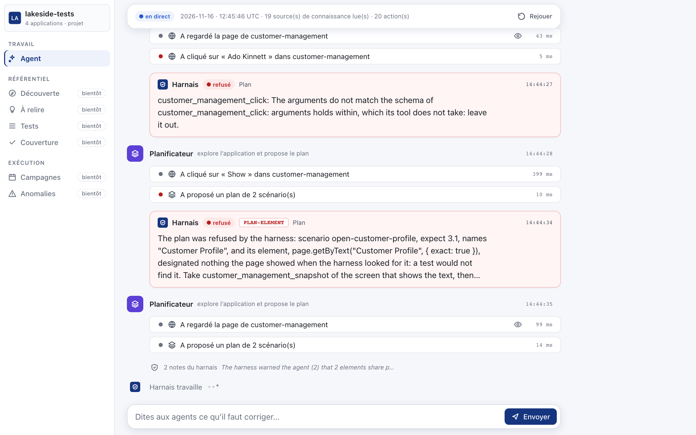

<h1 align="center">Open QA Stack</h1>

<p align="center"><strong>Test campaigns for Playwright, drafted by agents and decided by people.</strong></p>

<p align="center">
  The open source QA suite that turns what you know of your applications into end-to-end tests you can trust.<br>
  Agents do the work. A harness holds them to the evidence. Your team keeps the decision.
</p>

<p align="center">
  <a href="https://github.com/open-qa-stack/test-management/actions/workflows/ci.yml"></a>
  <a href="LICENSE"></a>
  <a href="https://playwright.dev"></a>
</p>

<p align="center">
  <a href="docs/getting-started.md">Get started</a> ·
  <a href="packages/domain/docs/configuration.md">Configuration</a> ·
  <a href="apps/cli/docs/oqas-command.md">The command</a> ·
  <a href="CONTRIBUTING.md">Contributing</a>
</p>

---

## Testing is the bottleneck. Agents alone do not fix it.

Software ships faster than it can be tested. Automated end-to-end tests are slow to write, costly to maintain, and the first thing a team drops under pressure.

An AI agent writes tests in minutes — tests that pass. Locators it guessed, assertions weakened until they held, the same journey five times under five names. A suite nobody can vouch for is a risk, not an asset.

**Open QA Stack gives you the speed of agents with the rigour of a QA team.**

## How it works

<p align="center">
  
</p>

Specialised agents work in turn, level by level: smoke, functional, business, cross-application, then visual. Each level builds on the tests of the one before. At every step a harness checks what the agents submit against what was really seen in your application — and refuses the rest.

## The whole flow

<p align="center">
  
</p>

First, agents map what you know: each source once, kept until it changes, grouped by business domain. Then, for each level, a planner explores your application and proposes scenarios, a reviewer sets aside what is already tested, a writer writes each Playwright test and runs it, and two more reviewers check it against its plan and for code quality.

Then your team decides. Each test waits for review: validate it, set it aside, or ask for a correction, which the writer makes. A correction can be kept as an instruction the agents read before every task.

Every step, every agent and every rule of the harness: [Inside a session](docs/how-it-works.md).

## Watch the agents work

<p align="center">
  
</p>

The console shows the agents at work, live: what each of them thinks, what it tells the others, what it does, and every time the harness says no — with the reason. Nothing in it is sample data: it follows the sessions of your test repository event by event, a session can be spoken to and stopped from it, and one that ended can be replayed step by step. `oqas --ui` is all it takes to open it. Beside the agents, the console holds the tests to review, the defects, the memory of the agents, the tests of your repository, their executions and your campaigns.

## What you get

- **Coverage that follows your test pyramid.** From "the application answers" to journeys across several applications and visual regression — each level planned by an agent that does only that.
- **Proof behind every test.** A locator comes from a screen that was opened, an expected value from a source that returned it. Every test is run before it is kept, and you get a verdict per test.
- **No duplicates, no noise.** A scenario that verifies what an existing test already verifies is set aside, with the reason. Your suite grows with what is new.
- **Tests you own.** A standard Playwright project in your own git repository: page objects, fixtures, tags by level and by domain. It runs without Open QA Stack. No lock-in.
- **Safe on your environments.** It runs on your machine, against your test environment. A test that changes existing data puts it back, even when it fails. Nothing is pushed: every run is a branch your team reviews.
- **Your rules.** Your pyramid, your architecture, your test charter. Open source, under Apache-2.0.

## People decide

Nothing an agent produces is taken on trust, and nothing is thrown away. A scenario set aside, a test that fails, a request your application does not allow: each is kept with who decided, why and when. Your team reads a branch, a plan and a verdict — and merges, or does not.

## Try it

```sh
vim oqas.json                                            # declare your applications, what you know of them, your model
oqas --init                                              # make your test repository a Playwright project
oqas                                                     # ask for tests, in your words
```

Three steps, and the first one is yours: `oqas.json` is where you say what to test and what is known of it. The last opens a conversation in your terminal: you type what you want tested — `search a customer and open their profile` — and watch the agents work. Open QA Stack is run from a clone of this repository, against a test environment, with a model you bring. [Get started](docs/getting-started.md) takes you from an empty folder to tests on a branch, and [the configuration](packages/domain/docs/configuration.md) says what goes in the file.

To watch the agents in a browser, run `oqas --ui` in your test repository and open the address it prints: [the console](apps/web/README.md), served by the command itself, with no database to install and no server to start — [Get started](docs/getting-started.md#watch-the-agents-work). An instance to share is a server that stays, and can keep its database on a PostgreSQL server.

## Contributing

Read [CONTRIBUTING.md](CONTRIBUTING.md) first. `pnpm check` tells whether a commit can be delivered: type check, lint, format, build, coverage directives, secrets, tests at full coverage, and the tests of the lint rules. Contributions are accepted under the [contributor license agreement](CLA.md): you keep your copyright, the project keeps one legal basis.

## License

Open QA Stack is licensed under the [Apache License, Version 2.0](LICENSE) (`Apache-2.0`).

Copyright 2026 Quentin Joly and the Open QA Stack contributors.
