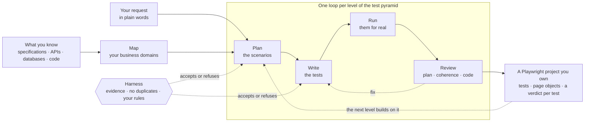

<h1 align="center">Open QA Stack</h1>

<p align="center"><strong>Test campaigns for Playwright, drafted by agents and decided by people.</strong></p>

<p align="center">
  The open source QA suite that turns what you know of your applications into end-to-end tests you can trust.<br>
  Agents do the work. A harness holds them to the evidence. Your team keeps the decision.
</p>

<p align="center">
  <a href="LICENSE"></a>
  
  
</p>

<p align="center">
  <a href="docs/getting-started.md">Get started</a> ·
  <a href="packages/shared/docs/configuration.md">Configuration</a> ·
  <a href="packages/cli/docs/solo-command.md">The command</a> ·
  <a href="CONTRIBUTING.md">Contributing</a>
</p>

---

## Testing is the bottleneck. Agents alone do not fix it.

Software ships faster than it can be tested. Automated end-to-end tests are slow to write, costly to maintain, and the first thing a team drops under pressure.

An AI agent writes tests in minutes — tests that pass. Locators it guessed, assertions weakened until they held, the same journey five times under five names. A suite nobody can vouch for is a risk, not an asset.

**Open QA Stack gives you the speed of agents with the rigour of a QA team.**

## How it works



Specialised agents work in turn, level by level: smoke, functional, business, cross-application, then visual. Each level builds on the tests of the one before. At every step a harness checks what the agents submit against what was really seen in your application — and refuses the rest.

## What you get

- **Coverage that follows your test pyramid.** From "the application answers" to journeys across several applications and visual regression — each level planned by an agent that does only that.
- **Proof behind every test.** A locator comes from a screen that was opened, an expected value from a source that returned it. Every test is run before it is kept, and you get a verdict per test.
- **No duplicates, no noise.** A scenario that verifies what an existing test already verifies is set aside, with the reason. Your suite grows with what is new.
- **Tests you own.** A standard Playwright project in your own git repository: page objects, fixtures, tags by level and by domain. It runs without Open QA Stack. No lock-in.
- **Safe on your environments.** It runs on your machine, against your test environment. A test that changes existing data puts it back, even when it fails. Nothing is pushed: every run is a branch your team reviews.
- **Your rules.** Your pyramid, your architecture, your test charter. Open source, under Apache-2.0.

## People decide

Nothing an agent produces is taken on trust, and nothing is thrown away. A scenario set aside, a test that fails, a request your application does not allow: each is kept with who decided, why and when. Your team reads a branch, a plan and a verdict — and merges, or does not.

## Try it

```sh
oqas --init                                             # make your test repository a Playwright project
oqas --brief "search a customer and open their profile"  # ask for tests, in your words
```

Open QA Stack is run from a clone of this repository, against a test environment, with a model you bring. [Get started](docs/getting-started.md) takes you from an empty folder to tests on a branch.

## Contributing

Read [CONTRIBUTING.md](CONTRIBUTING.md) first. `pnpm check` tells whether a commit can be delivered: type check, lint, format, build, coverage directives, secrets, tests at full coverage, and the tests of the lint rules. Contributions are accepted under the [contributor license agreement](CLA.md): you keep your copyright, the project keeps one legal basis.

## License

Open QA Stack is licensed under the [Apache License, Version 2.0](LICENSE) (`Apache-2.0`).

Copyright 2026 Quentin Joly and the Open QA Stack contributors.
