# Inside a session

  

A session is what one request starts. It runs these steps in order, and the console shows each one live.

## 1. Cartography

The first time, and then only for the sources that changed, agents map what you know of your applications:

- the **source cartographer** reads an API or a database and writes its card;
- the **document cartographer** reads specifications section by section;
- the **application explorer** opens every screen and follows every link;
- the **domain writer** groups what they found by business domain;
- the **orchestrator** puts the sources together, and says why it sets anything aside.

The result is a knowledge base: domains, screens, endpoints and tables, each with where it was seen. A screen nobody opened or linked to is refused.

## 2. Design, by rounds

The design goes level by level — smoke, functional, business, cross-application, end-to-end, then visual — and starts again for a new round, until the batch holds 40 tests, or 3 rounds bring nothing new, or the time guardrail is reached.

- **The plan.** The **planner** explores the application and proposes scenarios. The harness checks every step against what was really seen: a value no screen showed, a locator that matches nothing or several elements, a sign-in the scenario does not make, a change of data said to be a read. A refused plan goes back to the planner with the reason. The **plan reviewer** then sets aside what an existing test already verifies.
- **The writing.** For each scenario, the **writer** writes the test and its page objects, and runs it three times. The harness checks how it closes: a failure is blamed on the application or on the test with evidence, and a test is not given up before it has been repaired. The **coherence reviewer** checks the test does what its plan says, and the **code reviewer** checks it against your charter.
- Every test, its plan and the state of the design are committed on a branch `oqas/design-…`. Nothing is pushed.

## 3. Execution

Once the design is over, Playwright runs the whole suite, and each test gets a verdict: passed, or failing because of the application or of the test. The summary tells what was asked, what came of it, what is left and what it cost.

What is kept:

- **your test repository**, in git: tests, page objects, fixtures, tags by level and by domain, and the plan;
- **the instance**, in SQLite by default: the sessions and every event, the reviews, the defects, the memory, the campaigns, the executions and the configuration;
- **the traces**: every request, every refusal and every token.

## 4. People decide

The same operations exist in the console, in the terminal and through the API.

- **Review.** Each test waits to be validated or set aside. One set aside can be restored. A correction goes back to the session that wrote the test, and the writer repairs it.
- **Defects.** A test that fails can report a defect, which is then fixed, closed, or opened again.
- **Campaigns.** A campaign is planned against an environment, gets its tests, is made ready, launched, then closed.
- **Memory.** The agents read it before every task: your instructions, corrections kept as lessons, and what they noted while working. Each line can be reworded or set aside, never lost.
